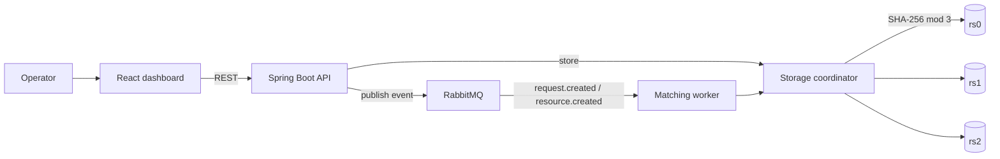

# Distributed Emergency Resource Matching System

A distributed platform that matches people requesting emergency help (food, water, medicine, transportation, shelter) with the nearest available resources or volunteers.

Built with Spring Boot, RabbitMQ, sharded MongoDB replica sets, React/Vite, Docker Compose, and Kubernetes (Minikube).

## Features

- REST API with JSON validation and structured error responses
- Asynchronous events through RabbitMQ and an independent matching worker
- Closest-resource matching (Haversine distance) within a configurable radius
- Deterministic SHA-256 sharding across three MongoDB replica sets (3 members each)
- Saga-style matching: atomic claim, conditional reservation, compensation and stale-attempt recovery
- Docker Compose for local development; Kubernetes with probes and worker autoscaling (HPA)
- React operator dashboard

## Tech Stack

| Area | Technology |
|---|---|
| Backend | Java 21, Spring Boot 3, Spring AMQP |
| Messaging | RabbitMQ 3.13 |
| Storage | MongoDB 7.0 (replica sets) |
| Frontend | React, Vite, Axios, Recharts |
| Infrastructure | Docker, Docker Compose, Kubernetes, Minikube |
| Build / Docs | Maven, npm, SpringDoc OpenAPI |

## Architecture



- **API** handles client requests, stores data, and publishes events.
- **Matching worker** consumes events independently and can be scaled horizontally.
- **Storage:** each request/resource ID maps to a shard via `SHA-256(id) mod 3`. Clients never need to know the shard. Writes use majority write concern; each replica set has three members (nine MongoDB containers/pods in total).

### How matching works

1. The API stores a request and publishes `request.created`.
2. A worker atomically claims it (`PENDING` → `PROCESSING`) with a unique attempt ID.
3. Candidates are filtered by type and quantity, then sorted by distance.
4. The closest resource within the radius is conditionally reserved.
5. The request is finalized as `MATCHED` only if that attempt still owns it.
6. On failure, the reservation is released and the request returns to `PENDING`.

Requests with no suitable resource stay `PENDING` and are retried when new resources arrive. A scheduled job returns stale `PROCESSING` requests to `PENDING` and reconciles reservation metadata after crashes.

## Quick Start (Docker Compose)

Requires Docker with the Compose plugin.

```bash
docker compose up --build
```

| Service | URL |
|---|---|
| Dashboard | http://localhost:5173 |
| API | http://localhost:8000 |
| Swagger UI | http://localhost:8000/docs |
| RabbitMQ management | http://localhost:15672 |

## Kubernetes (Minikube)

Requires Docker, `kubectl`, Minikube, and `envsubst`.

```bash
chmod +x scripts/deploy-minikube.sh
./scripts/deploy-minikube.sh
minikube service frontend -n emergency --url
```

The script starts Minikube, builds images, applies manifests from `kubernetes/`, initializes the three replica sets, and waits for rollouts. The API and frontend start with 2 replicas each; the matching worker starts with 2 and autoscales to 6 on CPU.

Scale manually:

```bash
./scripts/scale-service.sh 4
```

## API Overview

Full interactive docs are at `/docs`.

| Area | Endpoints |
|---|---|
| Requests | `POST /requests`, `GET /requests`, `GET /requests/{id}`, `PUT /requests/{id}/status` |
| Resources | `POST /resources`, `GET /resources`, `GET /resources/{id}`, `PUT /resources/{id}/status` |
| Matching | `POST /match/{id}`, `GET /match/{id}` |
| Monitoring | `/health`, `/health/ready`, `/stats`, `/system/overview` |
| Storage | `/storage/status`, `/storage/distribution`, `/storage/replication` |

## Configuration

Deployments read a root `.env` file:

```properties
MONGO_DB=emergency
MATCHING_RADIUS_KM=20
HEARTBEAT_TIMEOUT_SECONDS=30
RABBITMQ_USER=emergency
RABBITMQ_PASSWORD=emergency
API_PORT=8000
FRONTEND_PORT=5173
RABBITMQ_PORT=5672
RABBITMQ_MANAGEMENT_PORT=15672
```

MongoDB URIs are set per shard (`MONGO_SHARD{0,1,2}_URI` for Compose, `K8S_MONGO_SHARD{0,1,2}_URI` for Minikube). `VITE_API_URL` controls frontend API routing. Restart the API and worker after changing the matching radius or recovery timeout.

> `.env` is for local development only. Do not put production secrets in it.

## Development and Testing

```bash
# Backend (28 unit and MockMvc tests)
cd backend && mvn test

# Frontend
cd frontend && npm install && npm run build
```

Tests cover sharding, closest-resource matching, reservation failures, saga compensation, concurrent claim conflicts, stale-attempt recovery, worker events, and the REST endpoints.

Rebuild a single service: `docker compose up --build api matching-worker` (or `frontend`), or `./scripts/rebuild-backend.sh` / `./scripts/rebuild-frontend.sh` on Minikube.

## Fault Tolerance Demos

```bash
# Kill a worker; Kubernetes replaces it
kubectl -n emergency delete pod -l app=matching-worker

# Kill a MongoDB member; the replica set elects a new primary if needed
kubectl -n emergency delete pod mongo-rs0-0
kubectl -n emergency exec mongo-rs0-1 -- mongosh --quiet --eval 'rs.status()'
```

## Repository Layout

```text
.
├── backend/              Spring Boot API and matching worker
├── frontend/             React/Vite dashboard
├── database/initialization/  Replica-set init scripts
├── kubernetes/           Manifests (namespace, config, MongoDB, RabbitMQ, backend, frontend, HPA)
├── scripts/              Deploy, rebuild, and scale helpers
├── docker-compose.yml
└── .env
``` 

## Team

| Name | Roll Number |
|---|---|
| Abhijit Dibbidi | IMT2023054 |
| Vishnu Sai Prashanth Balla | IMT2023097 |
